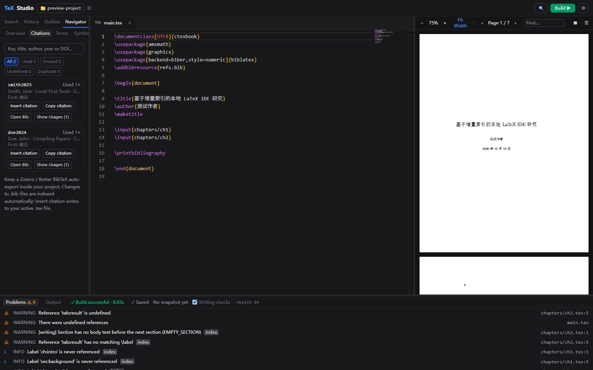

# LaTeX Studio V1.0

[](https://github.com/nanoandluna/latex-studio/actions/workflows/ci.yml)

**[Download the stable release](https://github.com/nanoandluna/latex-studio/releases/latest)** · [中文使用指南](docs/QUICKSTART.zh-CN.md) · [Upgrade from V0.5](docs/UPGRADE.md) · [V1.0 release notes](docs/RELEASE-v1.0.0.md)

A **local-first research writing workspace** for graduate students and researchers: open a local `.tex` project in your browser, edit it with Monaco, compile with your local TeX distribution, preview the PDF live, search across your entire project, take snapshots before risky edits, and see live diagnostics without building.

> 面向研究生与科研人员的本地优先科研写作工作台。
> Local-first · offline · no account · single user.



## What is new in V1.0

- **Recoverable drafts** — project-scoped browser sessions restore open tabs and unsaved text after reload. Storage failures are visible.
- **Reliable saves** — serialized per-file saves, atomic file publication, disk-conflict diff and explicit resolution. Typing during a save stays dirty.
- **Save before build** — all dirty files are saved before compilation; a save failure stops the build.
- **Verified recovery** — hash-checked snapshots restore deleted files and directories, with pre-restore protection.
- **Literature bridge** — search metadata/DOI, insert or copy citations, open papers, and follow Zotero / Better BibTeX file exports. Citation context follows the assembled include order.
- **Ready to run** — a prebuilt ZIP with launchers, local editor workers, lazy loading, patched dependencies and automated release verification.

## Features

### Core editing & compilation

- **Workspace** — open any local folder; file tree with create / rename / delete / refresh; automatic main-file detection (`main.tex`, then `\documentclass` scan); manual override.
- **Editor** — Monaco Editor with custom LaTeX language (syntax highlighting, bracket matching, folding, minimap), index-driven completions (`\cite`, `\ref`, `\includegraphics`, environments, packages), hover cards for citations and labels.
- **Compile** — latexmk / XeLaTeX / pdfLaTeX / LuaLaTeX via isolated CompilerService; single-flight build queue; timeout; output isolated to `.build/`; automatic BibTeX/Biber passes.
- **Auto Compile** — debounced rebuild after each save.
- **SyncTeX bidirectional** — Ctrl+Click source → PDF page; Ctrl+Click PDF → exact source line.

### Project Intelligence

- **Project Index** — incremental scanner tracking sections, labels, references, citations, figures, tables, equations, packages, includes; editor buffers re-indexed debounced without disk writes.
- **Outline & Navigator** — sidebar tabs: section tree with compiled numbering, whole-project navigator (figures / tables / equations / citations / labels) with usage-count badges and undefined/unused flags.
- **Live Diagnostics** — undefined references, duplicate labels, undefined citations appear in Problems without building.
- **Writing Checks** *(toggleable)* — repeated words, long sentences, TODO/FIXME, empty sections, suspicious punctuation.

### Writer's Safety

- **Snapshots** — atomic, SHA-256 verified, retention policy (max 30 + daily coalescing). Triggers: manual, pre-replace, pre-restore, build-ok (configurable).
- **History Browser** — timeline of all snapshots with per-file change summary.
- **Diff Viewer** — Monaco DiffEditor comparing any snapshot against current working tree.
- **Restore** — always writes a `pre-restore` safety snapshot first; validates every path through the workspace jail.
- **Replace All safety** — mandatory `pre-replace` snapshot before applying bulk replacements.

### Search & Statistics

- **Project Search** — `Ctrl+Shift+F`; case sensitivity, whole word, regex, glob filters; results grouped by file with click-to-jump.
- **Replace All** — preview → confirm → auto-snapshot → atomic apply.
- **Paper Statistics** — CJK characters · Latin words · numeric tokens counted separately; LaTeX commands/comments/math excluded; project/chapter/file aggregation.

### Portability

- **ZIP Export** — sources only (`.build/`, `.latex-studio/`, artifacts excluded).
- **ZIP Import** — path-jail validated, size-capped, refuses non-empty targets.

## Architecture

```text
┌───────────────────────────────────── Browser ────────────────────────────────────┐
│ React + Zustand stores (workspace/editor/build/index/preview/ui)                 │
│ Sidebar (Explorer·Outline·Navigator·Search·History) │ Monaco │ PDF.js │ Problems │
└──────────────────────────────────────┬───────────────────────────────────────────┘
                                       │ HTTP JSON API only (instance-token auth)
┌──────────────────────────────────────▼───────────────────────────────────────────┐
│ Fastify server                                                                   │
│  routes: workspace · files(+raw) · index · build · synctex(fwd/inv/diag)         │
│          · snapshots(CRUD+diff+restore) · search(+replace) · statistics          │
│  services: WorkspaceService · CompilerService · ProjectIndexService              │
│            · FileWatcher · SnapshotStore                                         │
│  security: safeResolve() jail · safeRealpathInside() · Host allow-list           │
│            · instance token                                                      │
└────────────────┬──────────────────────────────┬─────────────────────────────────┘
                 ▼                              ▼
          Local filesystem               latexmk / xelatex / biber / synctex …
                                          (spawn, shell:false)

Project flow:
  LaTeX project ──▶ ProjectIndex ──▶ Outline / Navigator / IntelliSense
                         │                    │
                    diagnostics ─────────▶ Problems panel
```

Monorepo layout:

```text
apps/
  web/                 React + Vite + Tailwind UI
  server/              Fastify API + compiler/workspace/index/snapshot services
packages/
  shared/              shared TypeScript types
  latex-parser/        LaTeX parsers + project-index builder + text statistics
templates/             template packages (article · report · beamer · ieee · acm · chinese)
tests/
  fixtures/            basic · chinese · multi-file(+bib) · bibliography(-biber)
                       beamer · ieee · biblatex · chinese-thesis · research-thesis
                       image · unicode-path · error projects
  e2e/                 Playwright specs
scripts/               doctor · release-check · generate-large-project · security-smoke
```

Key principle: the frontend never touches the filesystem or spawns processes — everything goes through the API. All paths jailed via `safeResolve()` + `safeRealpathInside()`.

## Release Verification

### 1. Install a TeX distribution

- Windows: [MiKTeX](https://miktex.org) or [TeX Live](https://tug.org/texlive). latexmk additionally needs Perl ([Strawberry Perl](https://strawberryperl.com)).
- macOS/Linux: TeX Live.

### 2. Verify tools in a NEW terminal

```bash
xelatex --version
latexmk --version
```

### 3. Doctor

```bash
pnpm run doctor          # human-readable, exit 0 = READY / exit 1 = NOT READY
pnpm run doctor --json   # machine-readable for CI
```

### 4. Full release check

```bash
pnpm release:check
```

Runs: `doctor → production build → typecheck → unit/integration + stress → production security smoke → dependency audit → real-LaTeX tests → real-build E2E`.

Individual steps:

```bash
pnpm test:latex       # real compilation fixtures incl. stale-PDF regression
pnpm test:e2e:latex   # real-build Playwright suite
pnpm test:stress      # 500/1000-chapter performance benchmarks
```

### Gate rules

All steps must pass. Real compilation requires XeLaTeX, pdfLaTeX, LuaLaTeX,
latexmk, BibTeX, Biber and SyncTeX; missing tools produce a hard BLOCKED failure.
Default development tests may skip real compilation. Release fixtures validate
actual `%PDF-` bytes, bibliography resolution and SyncTeX. Environment-specific
browser cases (e.g. missing compiler on a machine with TeX) are intentionally skipped.

GitHub CI checks Windows, macOS and Linux. The release workflow installs a full
fixture toolchain on Linux and runs this same gate.

## Security

Binds to `127.0.0.1` only. Protects against localhost CSRF / DNS-rebinding:

- **CORS** never reflects foreign origins.
- **Host allow-list** rejects DNS rebinding.
- **Instance token** — an HttpOnly SameSite=Strict cookie or `x-latex-studio-token` header authenticates API requests; the token bootstrap is origin-checked.
- **Path jail** — `safeResolve()` + `safeRealpathInside()` on every filesystem operation.
- **Structured errors** — `{ error: { code, message } }` throughout; frontend never string-matches.

Automated tests run with `NODE_ENV=test` (opts out of auth layer).

## Requirements

- Node.js ≥ 22.13, pnpm 11.18.0
- TeX distribution for compiling (MiKTeX / TeX Live; latexmk needs Perl on Windows)

## Installation & Run

For the release ZIP, extract it and run `start.cmd` (Windows) or `sh start.sh`
(macOS/Linux). The launchers install production dependencies on first use, then
serve the already-built application at <http://localhost:3210>. Keep the terminal
open. The ZIP is a Node application, not a native installer. First installation
requires network access; installed editor and PDF assets run locally.

For a source checkout:

```bash
npm install -g pnpm@11.18.0
pnpm install --frozen-lockfile
pnpm dev                  # development → http://localhost:5173
pnpm build
pnpm start                # production → http://localhost:3210
```

Open Workspace → enter an existing folder path or create a template → edit →
`Ctrl+S` → `Ctrl+B`. Use **Save All Files** in the command palette to save every tab.

## Testing

```bash
pnpm test             # unit + integration (no LaTeX needed)
pnpm test:latex       # real compilation tests (needs TeX)
pnpm test:stress      # 500/1000-chapter performance benchmarks
pnpm test:e2e         # Playwright suite
pnpm release:check    # the full gate
pnpm package:release  # source + prebuilt ZIP and SHA-256 (run after build)
```

## Developer Observability

`GET /api/graph/debug` exposes live Project Graph state — node/edge counts, revision, schema/parser versions, last-pass timings, recent watcher batches. Command Palette command dumps it to Output panel.

## Error codes

All API errors use `{ error: { code, message } }`:

`WORKSPACE_NOT_FOUND` · `WORKSPACE_NOT_OPEN` · `FILE_NOT_FOUND` · `PATH_FORBIDDEN` · `FORBIDDEN` · `UNAUTHORIZED` · `INVALID_FILE` · `INVALID_ARGUMENT` · `COMPILER_NOT_FOUND` · `BUILD_FAILED` · `BUILD_TIMEOUT` · `BUILD_CANCELLED` · `CONFLICT` · `SNAPSHOT_FAILED` · `REPLACE_FAILED` · `CONFIRMATION_REQUIRED` · `SEARCH_TIMEOUT` · `INVALID_ARCHIVE` · `PAYLOAD_TOO_LARGE` · `IMPORT_FAILED` · `EXPORT_FAILED` · `INTERNAL_ERROR`

Build states: `Ready → Building… → Build successful / Build failed / Cancelled / Timed out / No LaTeX compiler found`

## Troubleshooting

| Symptom | Fix |
| --- | --- |
| “No LaTeX environment detected” | Install MiKTeX/TeX Live, reopen terminal, restart server. |
| Build fails with `spawn … ENOENT` | Switch compiler in toolbar. |
| Chinese document shows blank glyphs | Use `ctexart`/`ctexbook` with XeLaTeX. |
| Port 3210 busy | Set `PORT=<n>` env var. |
| SyncTeX jump does nothing | Rebuild once (needs `-synctex=1` output). |

## Scope and limitations (V1.0)

- Chapter attribution follows the assembled document, so `\input`-ed prose counts toward its chapter; files that are not reachable from the main file keep per-file ranges and are listed after the include graph.
- The PDF outline rail sorts sections per file, not by true include order across files.
- Bibliography files remain managed by Zotero / Better BibTeX or your editor. The citation panel inserts commands into .tex files; it does not manage a reference-manager database.
- Reading position is stored per workspace in `.latex-studio/cache/reading-state.json` and resets when the cache is cleared.

- PDF search highlights matches per text-item; hyphenation across line ends may still be missed.
- Single workspace at a time; single user by design.
- Per-file parse cache persists in `.latex-studio/cache/` (schema-gated); assembled graph rebuilt in memory each session.
- Spell/grammar checking not provided.
- Filesystem notifications depend on the operating system; the browser probes graph revisions while visible and refreshes on focus.
- Project search scans raw file lines — comments and verbatim text are **not** excluded. Deliberate: Replace All must write back original lines, so search and replace must see the same text.
- Replace preview shows per-file counts rather than per-hunk before/after context; the real before/after is in History under the automatic `pre-replace` snapshot.
- Replace previews are held in memory for 10 minutes and are single-use; run Preview again after that.
- Dirty tabs keep their buffer after restore, replace-all or external writes; saving requires explicit disk-conflict resolution. Clean tabs re-sync automatically.
- Draft recovery uses browser local storage, scoped to workspace and origin; clearing browser data removes it. Use snapshots/export for independent backups.
- Snapshot restore is atomic per file; disk errors can leave a partial restore. Failed files are reported, with a pre-restore snapshot for recovery.

## Development direction

V1.0 completes the local research workspace: editing and compilation, project
intelligence, writer safety, literature use and PDF reading. Historical design
notes remain in `docs/V0.*-PLAN.md`; completed features are recorded in
[CHANGELOG.md](CHANGELOG.md). Future work can focus on native distribution,
include-order PDF outlines and richer replace previews.

Product razor: 只做让研究生更快、更稳定、更清晰地完成一篇高质量论文的功能。
